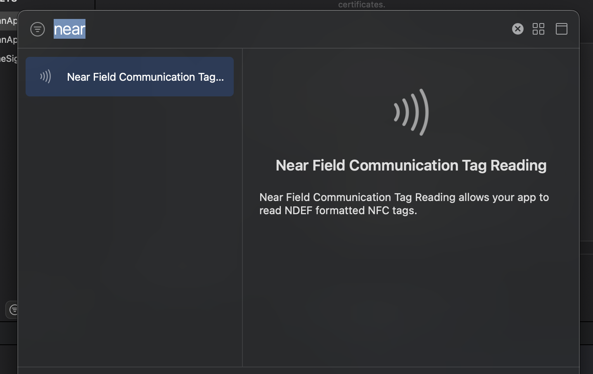

[Tiếng Việt](README.md) | **English**

# payme-mini-app

A React Native library that opens PayME Miniapp (wallet, payment, top-up, withdrawal, transfer, eKYC) in your app on iOS and Android.

Current version: **3.0.1**. The library already bundles the native SDKs (iOS `PayME-Miniapp` 0.8.3, Android `native-android` 0.8.4), so your app does not need to declare them.

## Contents

1. [Requirements](#requirements)
2. [Installation](#installation)
3. [App configuration](#app-configuration)
4. [Quick start](#quick-start)
5. [identityToken](#identitytoken)
6. [API](#api)
7. [Error codes](#error-codes)
8. [Upgrading from 2.x](#upgrading-from-2x)
9. [Support](#support)

## Requirements

- React Native 0.71 or later.
- iOS 13.0 or later (or your React Native version's minimum, if higher), built with Xcode 26.2 or later. Building with Xcode 27 needs the `post_install` block in [iOS installation](#ios).
- Android `minSdkVersion` 26, `compileSdkVersion` 37.
- An `appId`, `publicKey`, `privateKey` key set issued by PayME.
- Your server can call PayME's `identityToken` API.

## Installation

```sh
npm install payme-mini-app@^3.0.1
```

### iOS

Add to `ios/Podfile`:

```ruby
use_frameworks! :linkage => :static

target 'YourApp' do
  # ... keep use_react_native!(...) as is

  $dynamic_framework = [
    'PayMEMiniApp', 'CryptoSwift', 'SwiftyRSA', 'GCDWebServer', 'NSLogger', 'lottie-ios',
    'SwiftyJSON', 'ZIPFoundation', 'Mixpanel-swift', 'jsonlogic', 'json-enum', 'MixpanelSwiftCommon'
  ]

  pre_install do |installer|
    installer.pod_targets.each do |pod|
      if $dynamic_framework.include?(pod.name)
        def pod.build_type
          Pod::BuildType.dynamic_framework
        end
      end
    end
  end

  post_install do |installer|
    # keep react_native_post_install(...) as is
    installer.pods_project.targets.each do |target|
      target.build_configurations.each do |config|
        if $dynamic_framework.include?(target.name)
          config.build_settings['BUILD_LIBRARY_FOR_DISTRIBUTION'] = 'YES'
        end
        # Raise pods whose minimum iOS is lower than the app's (Xcode 27 errors below 15.0)
        if config.build_settings['IPHONEOS_DEPLOYMENT_TARGET'].to_f < min_ios_version_supported.to_f
          config.build_settings['IPHONEOS_DEPLOYMENT_TARGET'] = min_ios_version_supported
        end
      end
    end
  end
end
```

```sh
cd ios && pod install
```

### Android

1. **JitPack.** React Native already adds `https://www.jitpack.io`. If your project turns this off (`includeJitpackRepository=false`) or declares repositories in `settings.gradle`, add `maven { url 'https://www.jitpack.io' }` to the repository list.
2. **SDK versions** in `android/build.gradle`:

   ```groovy
   buildscript {
     ext {
       minSdkVersion = 26
       compileSdkVersion = 37
     }
   }
   ```

   If the Android Gradle Plugin says it does not support `compileSdk` 37 yet, upgrade AGP.
3. **ProGuard.** If your release build enables `minifyEnabled`, add to `android/app/proguard-rules.pro`:

   ```proguard
   -keep class vn.kalapa.ekyc.** { *; }
   -keepclassmembers,allowobfuscation class * {
       @com.google.gson.annotations.SerializedName <fields>;
   }
   ```

## App configuration

### iOS

Add to `Info.plist` (adjust the descriptions to fit your app):

```xml
<!-- Open bank apps when topping up -->
<key>LSApplicationQueriesSchemes</key>
<array>
  <string>vcbpartner</string>
  <string>bidv.smartbanking.partner</string>
</array>
<key>NSCameraUsageDescription</key>
<string>The app uses the camera for identity verification and to scan payment codes</string>
<key>NSPhotoLibraryUsageDescription</key>
<string>The app needs access to your photo library to choose a payment code</string>
<key>NSPhotoLibraryAddUsageDescription</key>
<string>The app needs to save payment codes to your photo library</string>
<key>NSContactsUsageDescription</key>
<string>Allow access to contacts to pick phone numbers quickly</string>
<key>NSFaceIDUsageDescription</key>
<string>Use Face ID for fast and secure authentication</string>
<!-- Read the citizen ID card chip during eKYC -->
<key>NFCReaderUsageDescription</key>
<string>Read the citizen ID card chip for identity verification</string>
<key>com.apple.developer.nfc.readersession.iso7816.select-identifiers</key>
<array>
  <string>A0000002471001</string>
  <string>A0000002472001</string>
  <string>00000000000000</string>
</array>
<!-- Miniapp runs on a local web server (the React Native template already has this) -->
<key>NSAppTransportSecurity</key>
<dict>
  <key>NSAllowsLocalNetworking</key>
  <true/>
</dict>
```

In Xcode, open your app target → **Signing & Capabilities** → **+ Capability** → add **Near Field Communication Tag Reading**.



### Android

No permissions to declare. The SDK already includes the permissions it needs, and Miniapp requests them when needed.

## Quick start

```tsx
import { useEffect } from 'react';
import { addErrorListener, addResponseListener, init, open } from 'payme-mini-app';

export function usePayME() {
  useEffect(() => {
    // Register listeners before init/open: on iOS, events emitted with no listener are dropped.
    const subs = [
      addResponseListener((e) => console.log('PayME response', e.action)),
      addErrorListener((e) => console.log('PayME error', e.action, e.code, e.description)),
    ];
    init('<APP_ID>', '<PUBLIC_KEY>', '<PRIVATE_KEY>', 'vi', 'SANDBOX');
    return () => subs.forEach((s) => s.remove());
  }, []);
}

// identityToken is fetched from PayME by your server
export function openWallet(identityToken: string) {
  open('modal', { action: 'OPEN', identityToken });
}
```

> Do not put real keys in public source code. Write `publicKey` and `privateKey` on one line, without line breaks (for example `-----BEGIN PUBLIC KEY-----MFww...-----END PUBLIC KEY-----`).

## identityToken

`identityToken` is a string PayME issues for each of your users. Your app passes it every time it opens Miniapp.

1. Your app calls your server.
2. Your server calls PayME's `identityToken/init` API with the user's phone number (contact PayME for the API docs). Do not call this API from the app.
3. Your app passes the returned `identityToken` to `open`, `getBalance` or `getAccountInfo`.

| Action / function | `identityToken` |
| --- | --- |
| `PAYME` | Not used (the user signs in themselves) |
| `PAYMENT` | Optional. With it, the user can pay with their PayME wallet; without it, they pay as a guest (card, QR) |
| Other actions, `getBalance`, `getAccountInfo` | Required |

- The token is valid for 15 minutes and can be reused during that time.
- Invalid or expired: `onError` returns `401` (Miniapp closes if it is open). Get a new token and call again.
- Keep the token in memory only: do not store it, do not log it.

## API

All functions return `void`. Results and errors come back through the `onResponse` and `onError` events.

### init

```ts
init(appId, publicKey, privateKey, locale?, env?, mode?)
```

| Parameter | Description |
| --- | --- |
| `appId` | App ID issued by PayME |
| `publicKey` | PayME's public key |
| `privateKey` | Your app's private key |
| `locale` | `'vi'` (default) or `'en'` |
| `env` | `'PRODUCTION'` (default), `'SANDBOX'` or `'STAGING'` |
| `mode` | Usually not needed. Defaults to `'miniapp_sandbox'` when `env` is `SANDBOX`, otherwise `'miniapp_product'` |

Call `init` once, before any other function. Calling another function before `init` gives the `PAYME_NOT_INITIALIZED` error.

### open

```ts
open(type, { action, identityToken?, data? })
```

`type`: `'screen'` (full screen) or `'modal'` (slides up from the bottom).

| `action` | Purpose | `data` |
| --- | --- | --- |
| `OPEN` | Wallet home (opens the activation flow if not activated yet) | None |
| `KYC` | Identity verification (eKYC) | None |
| `PAY` | Pay for your order | [`PayMEPaymentParam`](#paymepaymentparam-pay) |
| `PAYMENT` | Pay a transaction created through the PayME API | [`PayMEPaymentDirectParam`](#paymepaymentdirectparam-payment) |
| `TRANSFER_QR` | Transfer money to a bank account | [`PayMETransferQRParam`](#paymetransferqrparam-transfer_qr) |
| `SERVICE` | Pay for services (electricity, water, cards…) | [`PayMEServiceParam`](#paymeserviceparam-service) |
| `DEPOSIT`, `WITHDRAW`, `TRANSFER` | Top up, withdraw, transfer | [`PayMEPayParam`](#paymepayparam-deposit-withdraw-transfer) |
| `PAYME` | The full PayME wallet; the user signs in themselves | None |

```ts
open('screen', {
  action: 'PAY',
  identityToken,
  data: { transactionId: 'ORDER_123', amount: 10000, note: 'Order 123' },
});
open('modal', { action: 'PAYMENT', data: { transaction: '<TRANSACTION>' } }); // guest
open('screen', { action: 'SERVICE', identityToken, data: { service: 'POWE' } });
open('screen', { action: 'DEPOSIT', identityToken, data: { amount: 50000 } });
```

With invalid parameters (missing `data`, missing a required field, non-integer `amount`, invalid `action`), Miniapp does not open and `onError` returns `INVALID_PARAM`.

`amount` is an integer in VND. Every `data` parameter below also accepts two optional fields: `extraData` (your own data, returned when the transaction succeeds) and `isShowResult` (show PayME's result screen, default `true`).

#### PayMEPaymentParam (PAY)

| Field | Required | Description |
| --- | --- | --- |
| `transactionId` | Yes | Your transaction ID |
| `amount` | Yes | Amount |
| `ipnUrl` | No | URL that receives transaction status notifications |
| `note` | No | Note |

#### PayMEPaymentDirectParam (PAYMENT)

| Field | Required | Description |
| --- | --- | --- |
| `transaction` | Yes | Transaction code PayME returns when you create the transaction |

#### PayMETransferQRParam (TRANSFER_QR)

| Field | Required | Description |
| --- | --- | --- |
| `amount` | Yes | Amount (`0` lets the user enter it) |
| `bankNumber` | Yes | Receiving account or card number |
| `swiftCode` | Yes | SWIFT code of the receiving bank |
| `cardHolder` | Yes | Account holder name |
| `note` | No | Note |
| `partnerTransaction` | No | Your transaction ID |

#### PayMEServiceParam (SERVICE)

| Field | Required | Description |
| --- | --- | --- |
| `service` | Yes | `POWE` (electricity), `WATE` (water), `ADSL` (internet), `TIVI` (TV), `PPMB` (postpaid), `MOBILE_CARD` (phone card), `MOBILE_TOPUP` (phone top-up), `GAME_CARD` (game card) |
| `isBackToApp` | No | Return to your app when done (default `true`) |

#### PayMEPayParam (DEPOSIT, WITHDRAW, TRANSFER)

| Field | Required | Description |
| --- | --- | --- |
| `amount` | No | Prefilled amount |
| `description` | No | Transaction description |
| `isBackToApp` | No | Return to your app when done (default `true`) |

`data` is required for these three actions; pass `{}` if you have no fields.

### getBalance, getAccountInfo

```ts
getBalance(identityToken)
getAccountInfo(identityToken)
```

Results come back through `onResponse`:

- `GET_BALANCE`: `linked` (whether the wallet is linked), `balance` (present when `linked` is `true`).
- `GET_ACCOUNT_INFO`: wallet account information.

### setLanguage, close

- `setLanguage('vi' | 'en')`: change the Miniapp language.
- `close()`: close the open Miniapp.

### Events

```ts
const errorSub = addErrorListener(({ action, code, description }) => { /* ... */ });
const responseSub = addResponseListener((data) => { /* data.action, ... */ });
// When no longer needed:
errorSub.remove();
responseSub.remove();
```

| Event | Payload | When |
| --- | --- | --- |
| `onResponse` | `{ action, ...data }` | A transaction succeeds, or a `getBalance` / `getAccountInfo` result arrives |
| `onError` | `{ action, code, description }` | An error occurs or the user closes Miniapp |

The `PayMEErrorCode` constant holds common error codes for comparison, for example `PayMEErrorCode.USER_CANCEL`.

### Opening and closing Miniapp

- Only one Miniapp can be open at a time. Calling `open` while one is open gives `MINIAPP_ALREADY_OPEN`.
- When Miniapp closes, you get its result exactly once: `onResponse`, `onError`, or `USER_CANCEL` when the user closes it. You can open again right inside this callback.
- Android: the back button closes popups, then goes back through Miniapp pages; when there are no pages left, it closes Miniapp and reports `USER_CANCEL`.
- `close()`: iOS reports `USER_CANCEL`, Android reports nothing.

## Error codes

| `code` | Meaning | What to do |
| --- | --- | --- |
| `401` | `identityToken` is invalid or expired | Get a new `identityToken` and call again |
| `IDENTITY_TOKEN_REQUIRED` | `identityToken` is missing | Pass `identityToken` |
| `INVALID_PARAM` | Invalid `open` parameters | Fix the parameters using the table in [open](#open) |
| `PAYME_NOT_INITIALIZED` | `init` was not called | Call `init` first |
| `USER_CANCEL` | The user closed Miniapp | Not an error |
| `MINIAPP_ALREADY_OPEN` | A Miniapp is already open | Wait for it to close, or call `close()` first |
| `MINIAPP_CANNOT_PRESENT` | Miniapp could not be shown | Call `open` while your app is in the foreground |
| Other codes | Network, server or business error | Show `description` and retry; contact PayME if it keeps happening |

## Upgrading from 2.x

Version 3.x replaces the phone number with `identityToken` and is not backward compatible.

| 2.x | 3.x |
| --- | --- |
| `open(type, { action, phone, data })` | `open(type, { action, identityToken, data })` |
| `open('screen', { action: 'PAYME', phone })` | `open('screen', { action: 'PAYME' })` |
| `getBalance(phone)` | `getBalance(identityToken)` |
| `getAccountInfo(phone)` | `getAccountInfo(identityToken)` |

1. Server: integrate the `identityToken/init` API (contact PayME).
2. `npm install payme-mini-app@^3.0.1`, then `cd ios && pod install`.
3. Replace every `phone` with `identityToken`; drop `phone` from the `PAYME` action.
4. Handle the `401` and `IDENTITY_TOKEN_REQUIRED` errors.
5. Build iOS with Xcode 26.2 or later.

## Support

PayME Technology Corporation, email [hotro@payme.vn](mailto:hotro@payme.vn). For the key set, the `identityToken/init` API docs and the API for creating `PAYMENT` transactions, contact PayME.

Version list: [npm `payme-mini-app`](https://www.npmjs.com/package/payme-mini-app?activeTab=versions).
