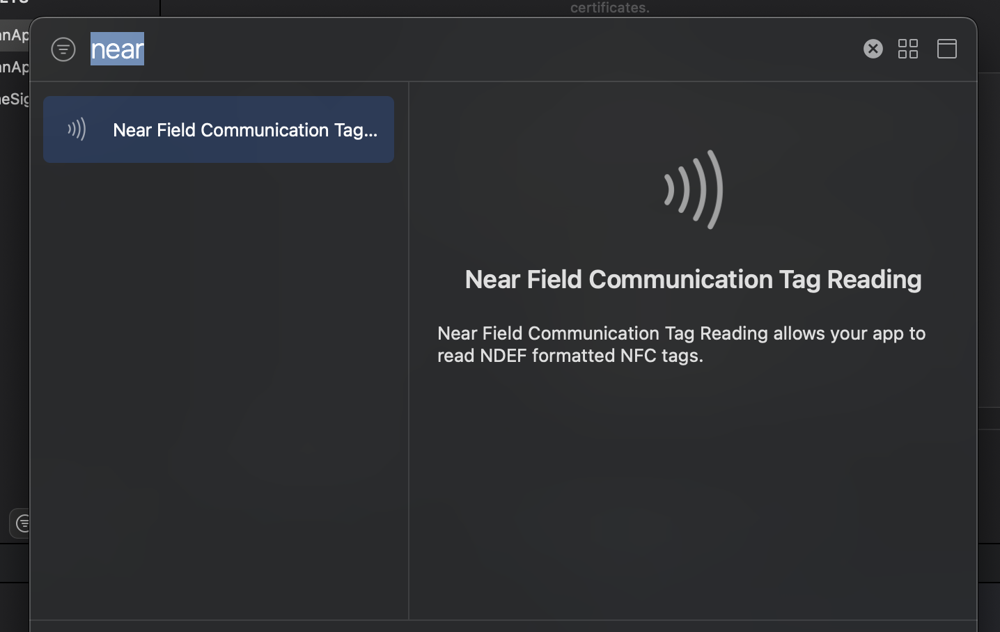
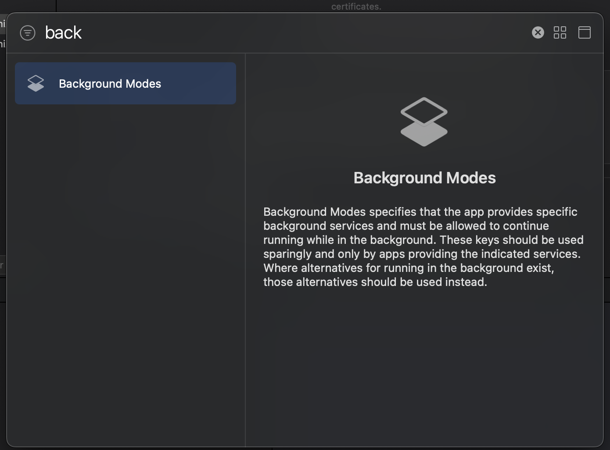
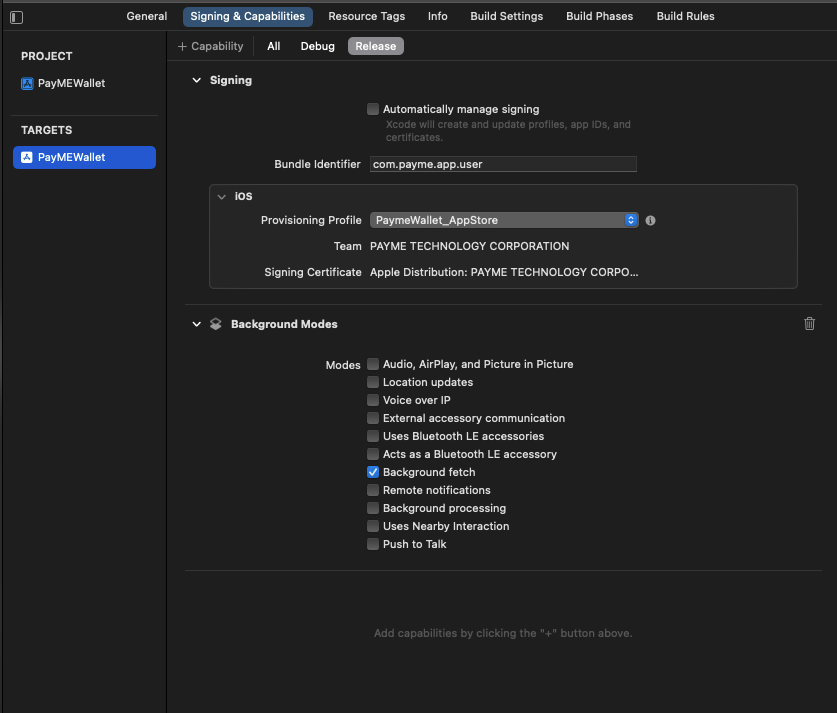

**Tiếng Việt** | [English](README.en.md)

# payme-mini-app

Thư viện React Native để tích hợp PayME Miniapp (ví điện tử, thanh toán, nạp, rút, chuyển tiền, eKYC) vào ứng dụng của đối tác trên iOS và Android.

| Gói | Phiên bản |
| --- | --- |
| npm `payme-mini-app` | **3.0.0** (không tương thích với 2.x) |
| iOS pod `PayME-Miniapp` | 0.8.1 |
| Android `com.github.PayME-Miniapp:native-android` | 0.8.2 (SDK 1.0.24) |

Hai SDK native được khai báo sẵn trong thư viện, ứng dụng không cần thêm trực tiếp.

## Mục lục

1. [Yêu cầu](#yêu-cầu)
2. [Cài đặt](#cài-đặt)
3. [Cấu hình ứng dụng](#cấu-hình-ứng-dụng)
4. [Bắt đầu nhanh](#bắt-đầu-nhanh)
5. [identityToken](#identitytoken)
6. [Tham chiếu API](#tham-chiếu-api)
7. [Mã lỗi](#mã-lỗi)
8. [Nâng cấp từ 2.x](#nâng-cấp-từ-2x)
9. [Lịch sử phiên bản và hỗ trợ](#lịch-sử-phiên-bản-và-hỗ-trợ)

## Yêu cầu

| Hạng mục | Yêu cầu |
| --- | --- |
| React Native | 0.71 trở lên. Ứng dụng mẫu được kiểm thử với React Native 0.85 |
| Kiến trúc | Thư viện là native module dạng bridge (legacy module). Chạy được cả khi bật New Architecture nhờ lớp interop của React Native (ứng dụng mẫu bật New Architecture) |
| iOS | iOS 13.0 trở lên (hoặc mức tối thiểu của phiên bản React Native bạn dùng, nếu cao hơn). **Xcode 26.2 trở lên** |
| Android | `minSdkVersion` 26, `compileSdkVersion` 37 |
| Bộ key | `appId`, `publicKey`, `privateKey` do PayME cấp cho từng ứng dụng |
| Server đối tác | Gọi được API cấp `identityToken` của PayME (xem [identityToken](#identitytoken)) |

## Cài đặt

```sh
npm install payme-mini-app@^3.0.0
# hoặc
yarn add payme-mini-app@^3.0.0
```

### iOS

Thư viện kéo pod `PayME-Miniapp` 0.8.1. Thêm cấu hình sau vào `ios/Podfile` (giống ứng dụng mẫu):

```ruby
use_frameworks! :linkage => :static

target 'YourApp' do
  # ... use_react_native!(...) như mặc định

  $dynamic_framework = [
    'PayMEMiniApp', 'CryptoSwift', 'SwiftyRSA', 'GCDWebServer', 'NSLogger', 'lottie-ios',
    'SwiftyJSON', 'ZIPFoundation', 'Mixpanel-swift', 'jsonlogic', 'json-enum', 'MixpanelSwiftCommon'
  ]

  pre_install do |installer|
    installer.pod_targets.each do |pod|
      if $dynamic_framework.include?(pod.name)
        def pod.build_type
          Pod::BuildType.dynamic_framework
        end
      end
    end
  end

  post_install do |installer|
    # react_native_post_install(...) như mặc định
    installer.pods_project.targets.each do |target|
      target.build_configurations.each do |config|
        if $dynamic_framework.include?(target.name)
          config.build_settings['BUILD_LIBRARY_FOR_DISTRIBUTION'] = 'YES'
          config.build_settings['IPHONEOS_DEPLOYMENT_TARGET'] = '13.0'
        end
      end
    end
  end
end
```

Sau đó chạy:

```sh
cd ios && pod install
```

### Android

**1. JitPack.** SDK Android được phát hành qua JitPack. React Native Gradle Plugin tự thêm `https://www.jitpack.io` cho mọi project, trừ khi bạn tắt bằng `includeJitpackRepository=false`. Nếu đã tắt, hoặc dự án khai báo repository trong `settings.gradle` với `RepositoriesMode.FAIL_ON_PROJECT_REPOS`, hãy thêm thủ công:

```groovy
// android/build.gradle
allprojects {
  repositories {
    maven { url 'https://www.jitpack.io' }
  }
}
```

**2. Phiên bản SDK.** SDK Android yêu cầu `minSdkVersion` 26 và `compileSdkVersion` 37 (template React Native 0.85 mặc định là 24 và 36):

```groovy
// android/build.gradle
buildscript {
  ext {
    minSdkVersion = 26
    compileSdkVersion = 37
    targetSdkVersion = 36
  }
}
```

Nếu Android Gradle Plugin của dự án báo chưa hỗ trợ `compileSdk` 37, hãy nâng AGP (ứng dụng mẫu dùng AGP 9.1.1).

**3. R8/ProGuard.** Nếu bản release bật `minifyEnabled true`, thêm vào `android/app/proguard-rules.pro`:

```proguard
-keep class vn.kalapa.ekyc.** { *; }
-keepclassmembers,allowobfuscation class * {
    @com.google.gson.annotations.SerializedName <fields>;
}
```

## Cấu hình ứng dụng

### iOS: Info.plist

| Key | Mục đích |
| --- | --- |
| `LSApplicationQueriesSchemes` | Mở ứng dụng ngân hàng khi nạp tiền qua deeplink |
| `NSCameraUsageDescription` | Chụp giấy tờ, khuôn mặt khi eKYC; quét mã QR |
| `NSPhotoLibraryUsageDescription` | Chọn ảnh mã QR từ thư viện |
| `NSPhotoLibraryAddUsageDescription` | Lưu ảnh mã QR vào thư viện |
| `NSContactsUsageDescription` | Chọn số điện thoại từ danh bạ (nạp tiền điện thoại) |
| `NSFaceIDUsageDescription` | Xác thực bằng Face ID |
| `NFCReaderUsageDescription` | Đọc chip CCCD qua NFC khi eKYC |
| `com.apple.developer.nfc.readersession.iso7816.select-identifiers` | Mã ứng dụng ISO 7816 của chip CCCD |
| `NSAppTransportSecurity` → `NSAllowsLocalNetworking` | Miniapp chạy trên web server cục bộ (`http://localhost`). Template React Native đã bật sẵn. Không cần `NSAllowsArbitraryLoads` |

```xml
<key>LSApplicationQueriesSchemes</key>
<array>
  <string>vcbpartner</string>
  <string>bidv.smartbanking.partner</string>
</array>
<key>NSCameraUsageDescription</key>
<string>Ứng dụng cần dùng máy ảnh để định danh và quét mã thanh toán</string>
<key>NSPhotoLibraryUsageDescription</key>
<string>Ứng dụng cần truy cập thư viện ảnh để chọn mã thanh toán</string>
<key>NSPhotoLibraryAddUsageDescription</key>
<string>Ứng dụng cần lưu mã thanh toán vào thư viện ảnh</string>
<key>NSContactsUsageDescription</key>
<string>Cho phép truy cập danh bạ để chọn nhanh số điện thoại</string>
<key>NSFaceIDUsageDescription</key>
<string>Dùng Face ID để xác thực nhanh và an toàn</string>
<key>NFCReaderUsageDescription</key>
<string>Đọc chip căn cước công dân để định danh</string>
<key>com.apple.developer.nfc.readersession.iso7816.select-identifiers</key>
<array>
  <string>A0000002471001</string>
  <string>A0000002472001</string>
  <string>00000000000000</string>
</array>
<key>NSAppTransportSecurity</key>
<dict>
  <key>NSAllowsArbitraryLoads</key>
  <false/>
  <key>NSAllowsLocalNetworking</key>
  <true/>
</dict>
```

### iOS: Capabilities

Trong Xcode, chọn target ứng dụng → **Signing & Capabilities** → **+ Capability**.

1. Thêm **Near Field Communication Tag Reading** (để đọc chip CCCD khi eKYC).

   

2. Thêm **Background Modes** và bật **Background fetch** (cấu hình mẫu của PayME).

   

   

### Android: quyền

Không cần khai báo thêm. Các quyền dưới đây nằm trong manifest của SDK và được Gradle tự gộp vào ứng dụng: `INTERNET`, `ACCESS_NETWORK_STATE`, `ACCESS_WIFI_STATE`, `CAMERA`, `READ_CONTACTS`, `NFC`, `READ_EXTERNAL_STORAGE`, `WRITE_EXTERNAL_STORAGE`, `ACCESS_LOCAL_NETWORK`. Quyền runtime (máy ảnh, danh bạ) do Miniapp tự xin khi cần.

## Bắt đầu nhanh

```tsx
import { useEffect } from 'react';
import { init, open, PayMEMiniAppEvents } from 'payme-mini-app';

export function usePayME() {
  useEffect(() => {
    // Gọi một lần, sau khi màn hình đầu tiên đã mount (Android cần Activity hiện tại).
    init('<APP_ID>', '<PUBLIC_KEY>', '<PRIVATE_KEY>', 'vi', 'SANDBOX', 'miniapp_sandbox');
    const subs = [
      PayMEMiniAppEvents.addListener('onResponse', (e) => console.log('PayME response', e)),
      PayMEMiniAppEvents.addListener('onError', (e) => console.log('PayME error', e)),
    ];
    return () => subs.forEach((s) => s.remove());
  }, []);
}

// identityToken do server của bạn lấy từ PayME, xem mục identityToken.
export function openWallet(identityToken: string) {
  open('modal', { action: 'OPEN', identityToken });
}
```

> Không đưa key thật vào mã nguồn công khai, README hay ảnh chụp màn hình. `publicKey` và `privateKey` viết trên một dòng, bỏ ký tự xuống dòng (ví dụ `-----BEGIN PUBLIC KEY-----MFww...-----END PUBLIC KEY-----`).

## identityToken

Từ 3.0.0, thư viện không nhận số điện thoại nữa. Mỗi lần mở Miniapp cho một người dùng, ứng dụng truyền `identityToken`: chuỗi do server PayME ký cho người dùng đó, gắn với `appId` của bạn.

**Luồng 3 bước**

1. Ứng dụng gọi server của bạn (đã xác thực người dùng).
2. Server của bạn gọi API `identityToken/init` của PayME (server tới server) với số điện thoại của người dùng và nhận `identityToken`. Liên hệ PayME để nhận tài liệu API này. Không gọi API này từ ứng dụng.
3. Ứng dụng truyền `identityToken` vào `open`, `getBalance` hoặc `getAccountInfo`.

| Action / hàm | `identityToken` |
| --- | --- |
| `OPEN`, `KYC`, `PAY`, `TRANSFER_QR`, `SERVICE`, `DEPOSIT`, `WITHDRAW`, `TRANSFER`, `getBalance`, `getAccountInfo` | Bắt buộc |
| `PAYMENT` | Tuỳ chọn. Có: người dùng trả được bằng ví PayME. Không có: thanh toán như khách vãng lai (thẻ, QR) |
| `PAYME` | Không dùng. Người dùng tự nhập số điện thoại và đăng nhập bằng PIN |

**Thời hạn**

- Chuỗi có hiệu lực 15 phút và dùng lại được nhiều lần trong thời gian đó.
- Sai hoặc hết hạn: Miniapp đóng (nếu đang mở) và `onError` trả `code` = `"401"`. Lấy chuỗi mới từ server rồi gọi lại.
- Chuỗi rỗng ở action/hàm bắt buộc: Miniapp không mở, `onError` trả `code` = `"IDENTITY_TOKEN_REQUIRED"`.

**Bảo mật**

- Chỉ giữ `identityToken` trong bộ nhớ: không ghi log, không lưu (AsyncStorage, MMKV, Keychain, file), không đưa lên URL hay analytics.
- Không đưa key ký hay thông tin gọi API `identityToken/init` vào ứng dụng.

## Tham chiếu API

```ts
import {
  init, open, getBalance, getAccountInfo, setLanguage, close, PayMEMiniAppEvents,
} from 'payme-mini-app';
```

Mọi hàm đều trả `void`. Kết quả và lỗi được trả bất đồng bộ qua [`PayMEMiniAppEvents`](#paymeminiappevents).

### init

```ts
declare function init(
  appId: string,
  publicKey: string,
  privateKey: string,
  locale?: 'vi' | 'en',                              // mặc định 'vi'
  env?: 'PRODUCTION' | 'STAGING' | 'SANDBOX',        // mặc định 'PRODUCTION'
  mode?: 'miniapp_sandbox' | 'miniapp_product',      // mặc định 'miniapp_product'
): void;
```

| Tham số | Bắt buộc | Mô tả |
| --- | --- | --- |
| `appId` | Có | Mã ứng dụng do PayME cấp (giá trị `x-api-client` trên dashboard) |
| `publicKey` | Có | Public key của PayME, viết trên một dòng |
| `privateKey` | Có | Private key của ứng dụng, viết trên một dòng |
| `locale` | Không | Ngôn ngữ giao diện |
| `env` | Không | Môi trường máy chủ PayME |
| `mode` | Không | `miniapp_sandbox` khi dùng `SANDBOX`, `miniapp_product` khi dùng `PRODUCTION` |

Lưu ý:

- Gọi `init` một lần, càng sớm càng tốt (SDK kiểm tra và tải bản Miniapp mới khi khởi tạo), và **trước mọi hàm khác**. Trên iOS, gọi `open`, `getBalance`, `getAccountInfo`, `setLanguage` hoặc `close` trước `init` sẽ làm ứng dụng crash.
- Android cần Activity hiện tại: gọi trong `useEffect` của component gốc, không gọi ở top-level module. Nếu chưa có Activity, các lệnh sau đó bị bỏ qua mà không báo lỗi.
- Đăng ký listener trước khi gọi `open`, `getBalance` hoặc `getAccountInfo`.

### open

```ts
declare function open(type: 'screen' | 'modal', param: PayMEOpeningParam): void;
```

| Tham số | Mô tả |
| --- | --- |
| `type` | `screen`: toàn màn hình. `modal`: trượt từ dưới lên |
| `param` | Object có `action`, `identityToken` (theo bảng ở [identityToken](#identitytoken)) và `data` (tuỳ action) |

`PayMEOpeningParam` chưa được export từ gói. Nếu cần kiểu này, lấy qua `Parameters`:

```ts
import { open } from 'payme-mini-app';

type PayMEOpeningParam = Parameters<typeof open>[1];
```

**Danh sách action**

| `action` | Chức năng | `identityToken` | `data` |
| --- | --- | --- | --- |
| `OPEN` | Mở trang chủ ví; nếu chưa kích hoạt ví thì mở luồng kích hoạt | Bắt buộc | Không có |
| `KYC` | Mở luồng định danh (eKYC) | Bắt buộc | Không có |
| `PAY` | Thanh toán đơn hàng của đối tác | Bắt buộc | [`PaymentParam`](#paymentparam-pay) |
| `PAYMENT` | Thanh toán giao dịch đối tác đã tạo sẵn | Tuỳ chọn | [`PaymentDirectParam`](#paymentdirectparam-payment) |
| `TRANSFER_QR` | Chuyển tiền từ ví PayME tới tài khoản ngân hàng do đối tác truyền | Bắt buộc | [`TransferQRParam`](#transferqrparam-transfer_qr) |
| `SERVICE` | Thanh toán dịch vụ (điện, nước, thẻ…) | Bắt buộc | [`ServiceParam`](#serviceparam-service) |
| `DEPOSIT` | Nạp tiền vào ví | Bắt buộc | [`PayParam`](#payparam-deposit-withdraw-transfer) |
| `WITHDRAW` | Rút tiền khỏi ví | Bắt buộc | [`PayParam`](#payparam-deposit-withdraw-transfer) |
| `TRANSFER` | Chuyển tiền | Bắt buộc | [`PayParam`](#payparam-deposit-withdraw-transfer) |
| `PAYME` | Mở toàn bộ ví PayME, người dùng tự đăng nhập | Không dùng | Không có |

Số tiền (`amount`) là số nguyên, đơn vị VND. `extraData` có kiểu `Record<string, string | object>`: dữ liệu riêng của đối tác, được trả lại khi giao dịch thành công. `isShowResult` và `isBackToApp` mặc định `true` trên cả hai nền tảng.

#### PaymentParam (PAY)

| Trường | Kiểu | Bắt buộc | Mô tả |
| --- | --- | --- | --- |
| `transactionId` | `string` | Có | Mã giao dịch của đối tác |
| `amount` | `number` | Có | Số tiền |
| `ipnUrl` | `string` | Có | URL nhận IPN khi giao dịch thay đổi trạng thái. Truyền `''` nếu không dùng |
| `note` | `string` | Không | Ghi chú |
| `extraData` | `Record<string, string \| object>` | Không | Dữ liệu riêng của đối tác |
| `isShowResult` | `boolean` | Không | Hiện màn hình kết quả của PayME |

#### PaymentDirectParam (PAYMENT)

Đối tác lấy danh sách phương thức và tạo giao dịch qua API của PayME (liên hệ PayME), rồi truyền mã giao dịch nhận được.

| Trường | Kiểu | Bắt buộc | Mô tả |
| --- | --- | --- | --- |
| `transaction` | `string` | Có | Mã giao dịch PayME trả về khi tạo giao dịch |
| `extraData` | `Record<string, string \| object>` | Không | Dữ liệu riêng của đối tác |
| `isShowResult` | `boolean` | Không | Hiện màn hình kết quả của PayME |

#### TransferQRParam (TRANSFER_QR)

| Trường | Kiểu | Bắt buộc | Mô tả |
| --- | --- | --- | --- |
| `amount` | `number` | Có | Số tiền (truyền `0` nếu để người dùng nhập) |
| `bankNumber` | `string` | Có | Số tài khoản hoặc số thẻ nhận |
| `swiftCode` | `string` | Có | Mã SWIFT của ngân hàng nhận |
| `cardHolder` | `string` | Có | Tên chủ tài khoản |
| `note` | `string` | Không | Ghi chú |
| `partnerTransaction` | `string` | Không | Mã giao dịch của đối tác |
| `extraData` | `Record<string, string \| object>` | Không | Dữ liệu riêng của đối tác |
| `isShowResult` | `boolean` | Không | Hiện màn hình kết quả của PayME |

#### ServiceParam (SERVICE)

| Trường | Kiểu | Bắt buộc | Mô tả |
| --- | --- | --- | --- |
| `service` | `string` | Có | Mã dịch vụ (bảng dưới) |
| `extraData` | `Record<string, string \| object>` | Không | Dữ liệu riêng của đối tác |
| `isBackToApp` | `boolean` | Không | Quay về ứng dụng đối tác sau khi hoàn tất |
| `isShowResult` | `boolean` | Không | Hiện màn hình kết quả của PayME |

| Mã dịch vụ | Dịch vụ |
| --- | --- |
| `POWE` | Điện |
| `WATE` | Nước |
| `ADSL` | Internet |
| `TIVI` | Truyền hình |
| `PPMB` | Điện thoại trả sau |
| `MOBILE_CARD` | Thẻ điện thoại |
| `MOBILE_TOPUP` | Nạp tiền điện thoại |
| `GAME_CARD` | Thẻ game |

#### PayParam (DEPOSIT, WITHDRAW, TRANSFER)

| Trường | Kiểu | Bắt buộc | Mô tả |
| --- | --- | --- | --- |
| `amount` | `number` | Không | Số tiền điền sẵn |
| `description` | `string` | Không | Mô tả giao dịch |
| `extraData` | `Record<string, string \| object>` | Không | Dữ liệu riêng của đối tác |
| `isBackToApp` | `boolean` | Không | Quay về ứng dụng đối tác sau khi hoàn tất |
| `isShowResult` | `boolean` | Không | Hiện màn hình kết quả của PayME |

`data` là bắt buộc với ba action này; truyền `{}` nếu không có trường nào.

**Ví dụ**

```ts
import { open } from 'payme-mini-app';

declare const identityToken: string; // lấy từ server của bạn

open('screen', {
  action: 'PAY',
  identityToken,
  data: { transactionId: 'ORDER_123', amount: 10000, ipnUrl: 'https://partner.example.com/ipn', note: 'Đơn hàng 123' },
});

open('modal', { action: 'PAYMENT', data: { transaction: '<TRANSACTION>' } }); // khách vãng lai
open('modal', { action: 'PAYMENT', identityToken, data: { transaction: '<TRANSACTION>' } }); // cho phép trả bằng ví

open('modal', {
  action: 'TRANSFER_QR',
  identityToken,
  data: { amount: 200000, bankNumber: '<BANK_NUMBER>', swiftCode: '<SWIFT_CODE>', cardHolder: 'NGUYEN VAN A' },
});

open('screen', { action: 'SERVICE', identityToken, data: { service: 'POWE' } });
open('screen', { action: 'DEPOSIT', identityToken, data: { amount: 50000 } });
open('screen', { action: 'KYC', identityToken });
open('screen', { action: 'PAYME' });
```

**Kiểm tra tham số**

- iOS: thiếu trường bắt buộc trong `data` (hoặc sai kiểu, ví dụ `amount` không phải số nguyên) ở `PAY`, `PAYMENT`, `TRANSFER_QR`, `SERVICE`, hoặc `action` không hợp lệ: Miniapp không mở, `onError` trả `code` = `"INVALID_PARAM"`.
- Android: thư viện không trả `INVALID_PARAM`; trường tuỳ chọn bị thiếu được điền mặc định (`note`, `ipnUrl`, `description` = `''`; `isShowResult`, `isBackToApp` = `true`). Hãy dựa vào kiểu TypeScript để luôn truyền đủ trường bắt buộc.

### getBalance

```ts
declare function getBalance(identityToken: string): void;
```

Lấy số dư ví của người dùng. Kết quả trả qua `onResponse` với `action` = `"GET_BALANCE"`:

| Trường | Kiểu | Mô tả |
| --- | --- | --- |
| `linked` | `boolean` | Người dùng đã liên kết ví với ứng dụng hay chưa |
| `balance` | `number` | Số dư (chỉ có khi `linked` = `true`) |
| `message` | `string` | Thông điệp từ máy chủ |

`identityToken` sai hoặc hết hạn: `onError` với `code` = `"401"`. Chuỗi rỗng: `"IDENTITY_TOKEN_REQUIRED"`.

### getAccountInfo

```ts
declare function getAccountInfo(identityToken: string): void;
```

Lấy thông tin tài khoản ví. Kết quả trả qua `onResponse` với `action` = `"GET_ACCOUNT_INFO"`; các trường còn lại là object `accountInfo` do máy chủ PayME trả về (có `accountId`). Không tìm thấy tài khoản: `onError` (`code` = `"OTHER"` trên Android, `"SERVER"` trên iOS). Lỗi `identityToken` giống `getBalance`.

### setLanguage

```ts
declare function setLanguage(language: string): void;
```

Đổi ngôn ngữ của Miniapp sau khi đã `init`. `'en'` là tiếng Anh; mọi giá trị khác được hiểu là `'vi'`.

### close

```ts
declare function close(): void;
```

Đóng Miniapp đang mở.

### PayMEMiniAppEvents

`NativeEventEmitter` phát hai sự kiện. `addListener` trả về subscription; gọi `remove()` khi không dùng nữa.

| Sự kiện | Payload | Khi nào |
| --- | --- | --- |
| `onResponse` | `{ action: string, ...dữ liệu }` | Một action hoàn tất (ví dụ thanh toán thành công), hoặc có kết quả `getBalance` / `getAccountInfo` |
| `onError` | `{ action: string, code: string, description: string }` | Có lỗi hoặc người dùng đóng Miniapp |

`action` là một trong: `PAYME`, `OPEN`, `KYC`, `PAY`, `PAYMENT`, `TRANSFER_QR`, `SERVICE`, `DEPOSIT`, `WITHDRAW`, `TRANSFER`, `GET_BALANCE`, `GET_ACCOUNT_INFO`.

Khác biệt giữa hai nền tảng:

| | iOS | Android |
| --- | --- | --- |
| `onResponse` | Payload gồm `action` và toàn bộ dữ liệu SDK trả về | Như iOS; không phát sự kiện khi SDK không có dữ liệu kèm theo |
| `onError` | Có thêm `INVALID_PARAM` (do thư viện kiểm tra tham số) | Không có `INVALID_PARAM` |
| Listener | Sự kiện phát khi chưa có listener sẽ bị bỏ | Sự kiện luôn được phát |

Thư viện không export kiểu cho payload; tự khai báo trong ứng dụng:

```ts
import { PayMEMiniAppEvents } from 'payme-mini-app';

type PayMEErrorEvent = { action: string; code: string; description: string };
type PayMEResponseEvent = { action: string; [key: string]: unknown };

const errorSub = PayMEMiniAppEvents.addListener('onError', (event) => {
  const { action, code, description } = event as PayMEErrorEvent;
  if (code === '401') {
    // identityToken hết hạn: lấy chuỗi mới từ server rồi mở lại
  }
  console.warn(action, code, description);
});

const responseSub = PayMEMiniAppEvents.addListener('onResponse', (event) => {
  const data = event as PayMEResponseEvent;
  if (data.action === 'GET_BALANCE') {
    console.log(data.linked, data.balance);
  }
});

// Khi unmount:
errorSub.remove();
responseSub.remove();
```

## Mã lỗi

`onError` trả `code` dạng chuỗi.

| `code` | Nền tảng | Ý nghĩa | Cách xử lý |
| --- | --- | --- | --- |
| `401` | iOS, Android | `identityToken` sai hoặc hết hạn. Miniapp đóng nếu đang mở | Lấy `identityToken` mới từ server rồi gọi lại |
| `IDENTITY_TOKEN_REQUIRED` | iOS, Android | Thiếu `identityToken` (chuỗi rỗng) ở action/hàm bắt buộc. Miniapp không mở | Lấy `identityToken` trước khi gọi |
| `INVALID_PARAM` | iOS | `action` không hợp lệ, hoặc `data` thiếu trường bắt buộc / sai kiểu | Sửa tham số theo [bảng action](#open) |
| `USER_CANCEL` | iOS, Android | Người dùng đóng Miniapp | Không phải lỗi; cập nhật giao diện nếu cần |
| `SYSTEM_CANCEL` | iOS | Không khởi động được Miniapp trên thiết bị | Thử lại; nếu lặp lại, liên hệ PayME |
| `CONNECTION_LOST` | iOS, Android | Mất kết nối mạng | Kiểm tra mạng rồi thử lại |
| `TIMED_OUT` | iOS, Android | Hết thời gian chờ máy chủ | Thử lại |
| `NO_RESPONSE` | iOS, Android | Máy chủ không phản hồi | Thử lại sau |
| `ENCODE_FAILED` | iOS, Android | Mã hoá request thất bại | Kiểm tra `publicKey`, `privateKey`, `appId` và `env` |
| `DECODE_FAILED` | iOS, Android | Giải mã response thất bại | Kiểm tra bộ key và `env` |
| `SERVER` | iOS | Máy chủ trả lỗi (xem `description`) | Hiển thị `description` hoặc thử lại |
| `SERVER_ERROR` | Android | Máy chủ trả lỗi | Thử lại sau |
| `OTHER` | iOS, Android | Lỗi khác (ví dụ không tìm thấy tài khoản khi `getAccountInfo`) | Hiển thị `description` |
| Mã khác | iOS, Android | Lỗi nghiệp vụ do Miniapp trả về | Hiển thị `description`; liên hệ PayME nếu cần tra mã |

## Nâng cấp từ 2.x

3.0.0 thay số điện thoại bằng `identityToken` và nâng SDK native từ 0.7.x lên 0.8.x. Không tương thích ngược.

| 2.x | 3.0.0 |
| --- | --- |
| `open(type, { action, phone, data })` | `open(type, { action, identityToken, data })` |
| `open('screen', { action: 'PAYME', phone })` | `open('screen', { action: 'PAYME' })` |
| `open(type, { action: 'PAYMENT', phone?, data })` | `open(type, { action: 'PAYMENT', identityToken?, data })` |
| `getBalance(phone)` | `getBalance(identityToken)` |
| `getAccountInfo(phone)` | `getAccountInfo(identityToken)` |
| iOS `PayME-Miniapp` 0.7.6 | iOS `PayME-Miniapp` 0.8.1, Xcode 26.2 trở lên |
| Android `native-android` 0.7.2 | Android `native-android` 0.8.2 (SDK 1.0.24) |
| — | Thêm xử lý `onError` với `code` `"401"` và `"IDENTITY_TOKEN_REQUIRED"` |

Các bước:

1. Server: tích hợp API `identityToken/init` của PayME (liên hệ PayME để nhận tài liệu và bật cho `appId`).
2. Ứng dụng: `npm install payme-mini-app@^3.0.0`, rồi `cd ios && pod install`.
3. Thay mọi `phone` bằng `identityToken`; bỏ `phone` ở action `PAYME`.
4. Xử lý `401` (lấy chuỗi mới) và `IDENTITY_TOKEN_REQUIRED`.
5. Build iOS bằng Xcode 26.2 trở lên.

`init`, `setLanguage`, `close`, `PayMEMiniAppEvents` và cấu trúc `data` của từng action không đổi.

## Lịch sử phiên bản và hỗ trợ

| Phiên bản | Thay đổi chính |
| --- | --- |
| 3.0.0 | `identityToken` thay số điện thoại; iOS `PayME-Miniapp` 0.8.1, Android `native-android` 0.8.2 (SDK 1.0.24) |
| 2.0.0 | iOS `PayME-Miniapp` 0.7.6, Android `native-android` 0.7.2; định danh bằng số điện thoại |

Danh sách phiên bản: [npm `payme-mini-app`](https://www.npmjs.com/package/payme-mini-app?activeTab=versions).

Hỗ trợ: PayME Technology Corporation, email [hotro@payme.vn](mailto:hotro@payme.vn), [payme.vn](https://payme.vn/web/home). Báo lỗi tài liệu: [GitHub Issues](https://github.com/PayME-Miniapp/payme-mini-app/issues). Bộ key, tài liệu API `identityToken/init` và API tạo giao dịch `PAYMENT`: liên hệ PayME.
